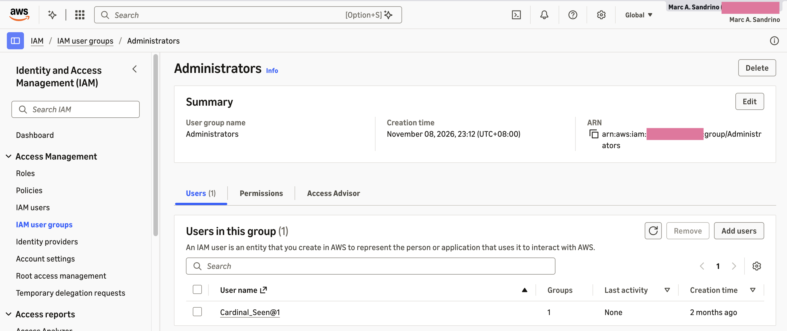
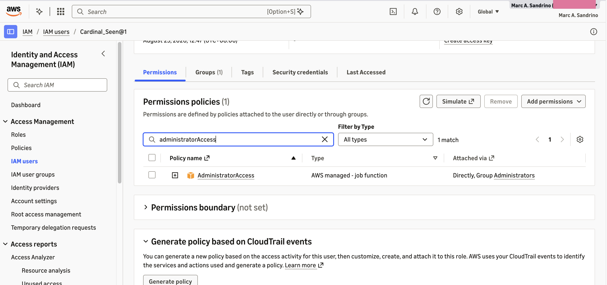
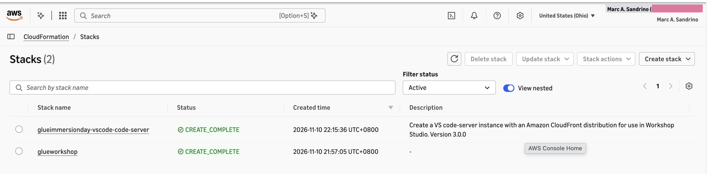
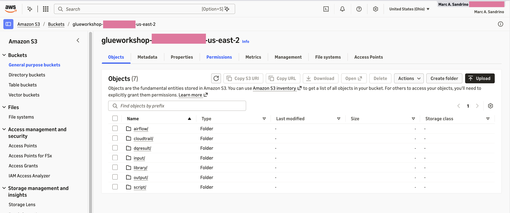

# Lab 0: Requirements and Setup

## 📚 Overview

Before you head into Lab 1, you'll need to sign up and set up your credentials so you have an active AWS account for the self-paced labs. This lab walks you through all the prerequisites needed to successfully complete the AWS Glue workshop series.

> **Important**: If you're new to AWS, always make sure to choose the **Free Tier** to minimize costs during learning.

## 💰 Cost Awareness

As a data engineer, **one of the key requirements is knowing and keeping track of the costs associated with each tool you use**. Throughout this workshop, we'll be conscious of:

- Worker allocation (reducing from 10 to 5 where possible)
- Resource cleanup after labs
- Using Free Tier eligible services when available
- Monitoring CloudWatch metrics for resource usage

## 📋 Prerequisites Checklist

- [ ] Active AWS Account with Free Tier
- [ ] IAM User with Administrator access
- [ ] CloudFormation stacks deployed
- [ ] Browser-based VS Code IDE running on EC2
- [ ] S3 bucket configured
- [ ] Lab files cloned and ready

## 🛠️ Step-by-Step Setup Guide

### Step 1: Create AWS Account

1. Navigate to [aws.amazon.com](https://aws.amazon.com)
2. Click **Create an AWS Account**
3. Follow the registration process
4. Select **Free Tier** options when available
5. Verify your email and payment method

### Step 2: Create IAM User and Administrator Group

Another requirement is to create an IAM user and set up a user group named **"Administrator"**, where you can also link your credentials as part of your role as a data engineer.

#### Create Administrator User Group

1. Sign in to the AWS Console
2. Navigate to **IAM** (Identity and Access Management)
3. Click **IAM user groups** in the left sidebar
4. Click **Create group**
5. Set **User group name** to `Administrators`
6. Attach the **AdministratorAccess** policy
7. Click **Create user group**



#### Create IAM User

1. Navigate to **IAM users**
2. Click **Add users**
3. Enter a **User name** (e.g., `Cardinal_Seen@1`)
4. Select **Provide user access to the AWS Management Console**
5. Choose **I want to create an IAM user**
6. Set a custom password or auto-generate one
7. Click **Next**

#### Attach User to Administrator Group

1. Select **Add user to group**
2. Check the **Administrators** group you just created
3. Click **Next**
4. Review and click **Create user**



**Security Best Practice**: Save your credentials securely and enable Multi-Factor Authentication (MFA) for additional security.

### Step 3: Deploy CloudFormation Stacks

Once you've created your user group and linked your account, you can set up the CloudFormation templates by creating two stacks:

#### Stack 1: glueworkshop

This stack sets up core resources including:
- **VPC** - Virtual Private Cloud for network isolation
- **S3 bucket** - Data storage for input/output files
- **IAM roles** - Service roles for Glue jobs (e.g., `AWSGlueServiceRole-glueworkshop`)
- **Glue jobs** - Pre-configured ETL jobs for the labs
- **RDS** - Relational database (for advanced labs)
- **Kinesis** - Streaming data service (for advanced labs)

#### Stack 2: glueimmersionday-vscode-code-server

This stack creates a browser-based VS Code IDE running on EC2, replacing the now-unavailable AWS Cloud9. This provides:
- EC2 instance running code-server
- CloudFront distribution for secure access
- Terminal access for running shell commands and AWS CLI

#### Deployment Steps

1. Navigate to **CloudFormation** in the AWS Console
2. Click **Create stack** > **With new resources (standard)**
3. Upload the CloudFormation template or provide the S3 URL
4. Follow the stack creation wizard
5. Wait for both stacks to reach **CREATE_COMPLETE** status



**Stack Status Overview**:
- **glueworkshop** - CREATE_COMPLETE
- **glueimmersionday-vscode-code-server** - CREATE_COMPLETE

Since we'll be using both of these in future labs, go ahead and get them both created.

### Step 4: Access Browser-Based VS Code IDE

1. Navigate to **CloudFormation** > **Stacks**
2. Select the `glueimmersionday-vscode-code-server` stack
3. Go to the **Outputs** tab
4. Copy the **CloudFront URL**
5. Open the URL in your browser
6. Enter the password (found in stack outputs or parameters)

This replaces AWS Cloud9 and provides a full VS Code experience in your browser.

### Step 5: Configure S3 Bucket and Clone Lab Files

The final requirement before diving into Lab 1 (Working with the Glue Data Catalog) is to set up your S3 bucket and clone the lab files using the browser-based VS Code IDE you just deployed, making sure to follow all the provided guidelines along the way.

#### Verify S3 Bucket Structure

1. Navigate to **Amazon S3** in the AWS Console
2. Locate your workshop bucket: `glueworkshop-{accountid}-us-east-2`
3. Verify the following folder structure exists:

```
glueworkshop-{accountid}-us-east-2/
├── airflow/
├── cloudtrail/
├── dqresult/
├── input/
│   ├── lab1/
│   │   ├── csv/
│   │   └── json/
│   └── lab2/
│       └── state/
├── library/
├── output/
└── script/
```



#### Clone Lab Files (Using VS Code IDE)

1. Open your browser-based VS Code IDE (from CloudFront URL)
2. Open the integrated terminal (Terminal > New Terminal)
3. Clone the workshop repository:

```bash
cd /project
git clone https://github.com/aws-samples/aws-glue-samples.git glue-workshop
cd glue-workshop
```

4. Verify the files are accessible:

```bash
ls -la
```

5. Set environment variables for convenience:

```bash
export BUCKET_NAME=glueworkshop-{your-account-id}-us-east-2
echo $BUCKET_NAME
```

## ✅ Verification Checklist

Before proceeding to Lab 1, ensure:

- ✅ AWS Account is active and Free Tier enabled
- ✅ IAM User created with Administrator access
- ✅ Administrators group configured with proper permissions
- ✅ Both CloudFormation stacks show CREATE_COMPLETE status
- ✅ Browser-based VS Code IDE is accessible via CloudFront URL
- ✅ S3 bucket exists with proper folder structure
- ✅ Lab files cloned to /project/glue-workshop
- ✅ Environment variables set (BUCKET_NAME)

## 🔒 Security Best Practices

As you set up your environment, keep these security practices in mind:

1. **Never share your AWS credentials** - Keep access keys and passwords secure
2. **Enable MFA** on your root account and IAM users
3. **Use IAM roles** for service-to-service access (not access keys)
4. **Review IAM policies** - Principle of least privilege
5. **Monitor CloudTrail logs** - Track API calls and user activity
6. **Set up billing alerts** - Get notified if costs exceed thresholds

## 💡 Cost Management Tips

1. **Stop EC2 instances** when not in use (VS Code IDE)
2. **Delete S3 objects** after completing labs (if no longer needed)
3. **Remove CloudFormation stacks** after workshop completion
4. **Monitor AWS Cost Explorer** regularly
5. **Set up AWS Budgets** with email alerts

## 🎯 What's Next?

Once all requirements are met, you're ready to proceed to:

👉 [Lab 01: Glue Data Catalog](../lab-01-glue-data-catalog/)

This lab will teach you how to create and manage metadata using both the AWS Console and AWS CLI.

## 📸 Screenshots Reference

All screenshots in this directory document the setup process:

1. **lab-req-01-iam-admin.png** - IAM Administrator group configuration
2. **lab-req-02-iam-admin-access.png** - IAM user permissions with AdministratorAccess policy
3. **lab-req-03-stacks.png** - CloudFormation stacks showing CREATE_COMPLETE status
4. **lab-req-04-glue-workshop.png** - S3 bucket structure with workshop folders

## ⚠️ Troubleshooting

### CloudFormation Stack Creation Fails

**Issue**: Stack creation rolls back with errors

**Solutions**:
- Check that you have sufficient permissions
- Verify the region supports all required services
- Ensure you haven't exceeded service quotas
- Review the Events tab for specific error messages

### Cannot Access VS Code IDE

**Issue**: CloudFront URL doesn't load

**Solutions**:
- Wait a few minutes for CloudFront distribution to deploy
- Check that the EC2 instance is running
- Verify security group rules allow HTTPS traffic
- Clear browser cache and try incognito mode

### S3 Bucket Not Found

**Issue**: Workshop bucket doesn't exist

**Solutions**:
- Verify the glueworkshop CloudFormation stack completed successfully
- Check that you're in the correct AWS region (us-east-2)
- Review stack outputs for the actual bucket name

### Lab Files Clone Fails

**Issue**: Git clone command fails in terminal

**Solutions**:
- Verify internet connectivity from EC2 instance
- Check that git is installed: `git --version`
- Try cloning with HTTPS instead of SSH
- Ensure /project directory exists and has write permissions

## 🎓 Learning Objectives

By completing Lab 0, you will:

- ✅ Understand AWS account setup and Free Tier benefits
- ✅ Know how to create and manage IAM users and groups
- ✅ Deploy infrastructure using CloudFormation templates
- ✅ Access browser-based development environments
- ✅ Navigate S3 bucket structures
- ✅ Use terminal commands for AWS CLI operations
- ✅ Apply security and cost management best practices

---

**Ready to begin your AWS Glue journey? Let's move to Lab 01!** 🚀
