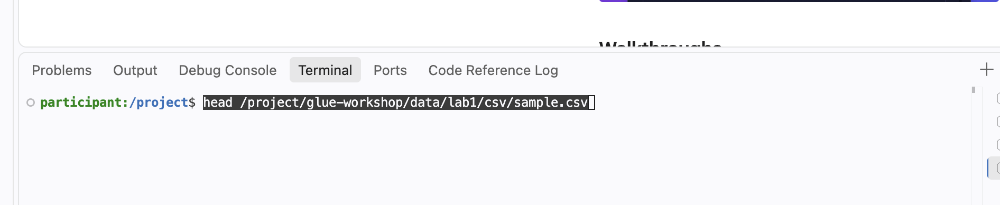
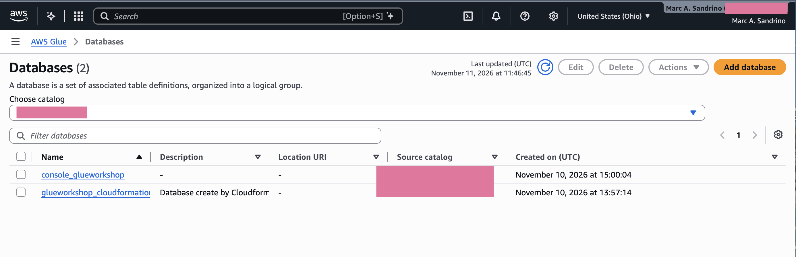
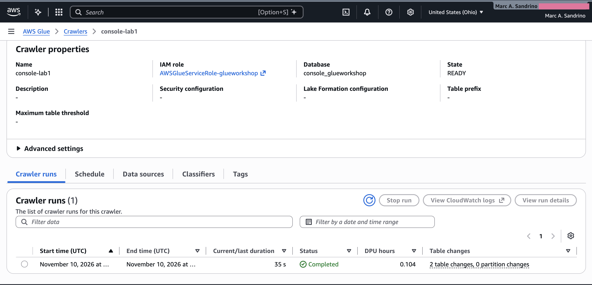
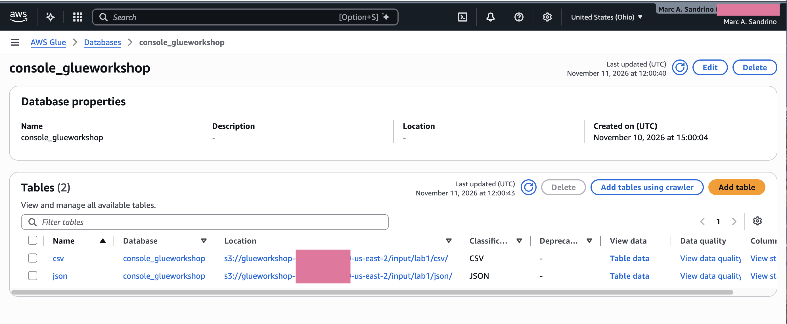
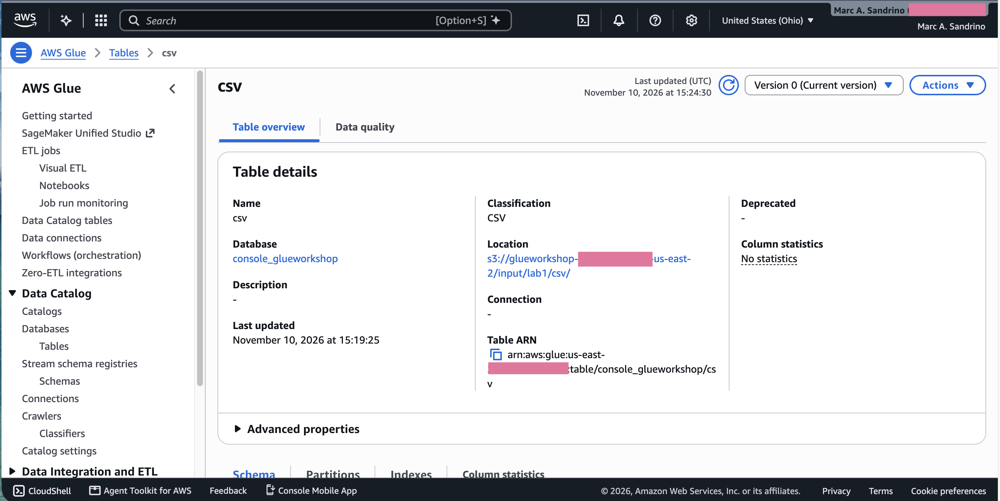
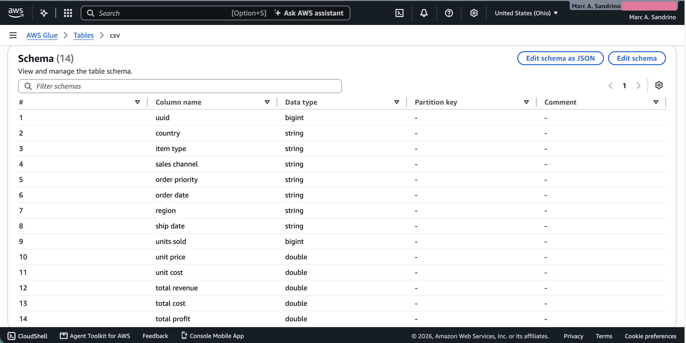
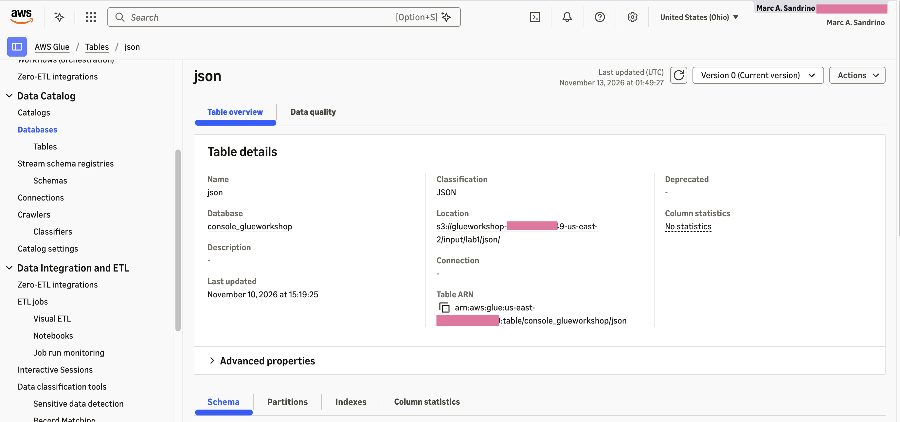
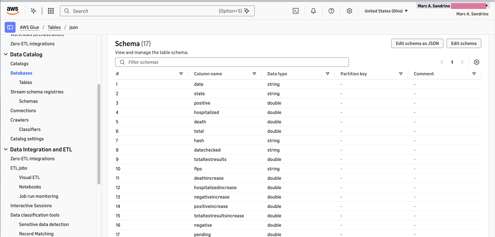

# Lab 1.1: AWS Console Approach

## 📚 Overview

This section demonstrates how to create and manage the AWS Glue Data Catalog using the **AWS Management Console**. The console provides an intuitive, visual interface that's perfect for learning the concepts and quick prototyping.

For background on AWS Glue Data Catalog and the comparison between localhost and cloud approaches, see the [main Lab 1 README](../README.md).

> **Note**: Built this AWS Console walkthrough to make getting started with the Glue Data Catalog faster and more approachable, though actual implementation and workflows should always align with the instructions and standards set by your Cloud Data Architect or Senior Data Engineer.

## 🖥️ Using AWS Console

### Step 1: Explore the Data Files

Before using the AWS Glue crawler to scan your files, you can explore the file contents directly inside Visual Studio Code by running this command in your terminal:

```bash
head /project/glue-workshop/data/lab1/csv/sample.csv
```



### Step 2: Access the Glue Data Catalog

Navigate to the AWS Console and click on **Databases** on the left under the **Data Catalog** section. There, you will see the `glueworkshop-cloudformation` database - pre-created by your CloudFormation template - which contains two pre-defined tables ready for use in the upcoming Glue streaming lab.



### Step 3: Create and Configure the Crawler

After you create the database, the next step is to set up your crawler by following the instructions outlined in the workshop. Configure the crawler properties including:
- **Name**: console-lab1
- **IAM Role**: AWSGlueServiceRole-glueworkshop
- **Database**: console_glueworkshop
- **State**: READY



### Step 4: Run the Crawler

Once the crawler is created, you can run it and check the results to see how it automatically populates your metadata catalog.



### Step 5: Verify the Tables

Once the crawler finishes running, you can navigate back to your `console_glueworkshop` database to verify that the tables were created, where you will see two newly populated tables: **csv** and **json**.



### Step 6: Explore CSV Table Details

Clicking on an individual table, such as **csv**, opens its detailed overview showing:
- Classification: CSV
- S3 Location
- Schema properties with 14 columns
- Metadata attributes



**Schema Details (14 columns):**
1. uuid - bigint
2. country - string
3. item_type - string
4. sales_channel - string
5. order_priority - string
6. order_date - string
7. region - string
8. ship_date - string
9. units_sold - bigint
10. unit_price - double
11. unit_cost - double
12. total_revenue - double
13. total_cost - double
14. total_profit - double

### Step 7: Explore JSON Table Details

Same with JSON properties - the table shows:
- Classification: JSON
- S3 Location
- Schema with 17 columns
- Connection details





**Schema Details (17 columns):**
1. date - string
2. state - string
3. positive - double
4. hospitalized - double
5. death - double
6. total - double
7. hash - string
8. datechecked - string
9. totaltestresults - double
10. fips - string
11. deathincrease - double
12. hospitalizedincrease - double
13. negativeincrease - double
14. positiveincrease - double
15. totaltestresultsincrease - double
16. negative - double
17. pending - double

## ✅ Key Takeaways

- AWS Glue Data Catalog automatically discovers and catalogs your data
- Crawlers scan data sources and infer schemas
- Metadata is organized into databases and tables
- Schema inference works for multiple formats (CSV, JSON, Parquet, etc.)
- The catalog integrates seamlessly with other AWS analytics services

## 📸 Screenshots Reference

All screenshots in this directory document the complete process from database creation through schema verification.

## 🔗 Next Steps

Continue to [Lab 1.2: AWS CLI](../lab-01-02-aws-cli/) to learn how to perform the same operations using command-line tools.
