# Lab 1.2: AWS CLI Approach

## 📚 Overview

This section demonstrates how to create and manage the AWS Glue Data Catalog using the **AWS Command Line Interface (CLI)**. The CLI approach is essential for automation, scripting, and Infrastructure as Code practices.

For background on AWS Glue Data Catalog and the comparison between localhost and cloud approaches, see the [main Lab 1 README](../README.md).

> **Note**: To get some hands-on coding practice, we will create another version of our Glue database and set up a crawler for both our CSV and JSON folders directly through the AWS CLI. This strengthens your programming skills and prepares you to execute infrastructure scripts provided by the Data Architect.

## 💻 Using AWS CLI

### Step 1: Inspect the Raw Data

Before we let the AWS Glue Crawler scan our files, let's inspect the raw data inside the VS Code IDE terminal so we can see its structure and later compare it against the crawler's inferred schema:

```bash
head /project/glue-workshop/data/lab1/csv/sample.csv
```

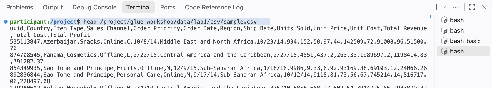

This command displays the first few rows of the CSV file, showing the column headers and sample data that will be cataloged.

### Step 2: Create the Database

Once you have inspected the sample data, create a new Glue database named `cli_glueworkshop` by running the following command:

```bash
aws glue create-database --database-input "{\"Name\":\"cli_glueworkshop\", \"Description\":\"This database is created using AWS CLI\"}"
```

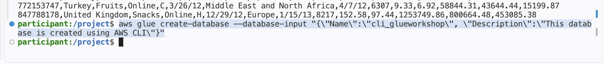

After executing that command, you will see your newly created `cli_glueworkshop` database appear in the AWS Glue Data Catalog.

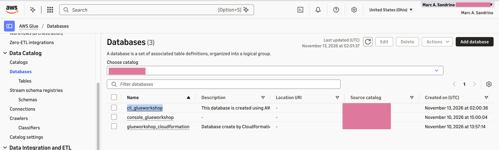

### Step 3: Create the Crawler

Next, create a Glue Crawler named `cli-lab1` that points to both the CSV and JSON S3 directories under `cli_glueworkshop` and applies a `cli_` prefix to the generated tables.

**Important**: Make sure to replace `${BUCKET_NAME}` with your actual S3 bucket name, or export your environment variables first if you opened a fresh terminal session.

```bash
aws glue create-crawler \
  --name cli-lab1 \
  --role AWSGlueServiceRole-glueworkshop \
  --database-name cli_glueworkshop \
  --table-prefix cli_ \
  --targets "{\"S3Targets\": [{\"Path\": \"s3://${BUCKET_NAME}/input/lab1/csv\"}, \
                              {\"Path\": \"s3://${BUCKET_NAME}/input/lab1/json\"}]}"
```

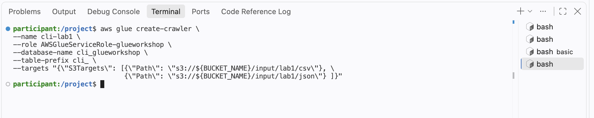

### Step 4: Start the Crawler

Once the crawler is created, trigger it via the CLI using the command below, keeping in mind that it will take a minute or two to finish scanning:

```bash
aws glue start-crawler --name cli-lab1
```

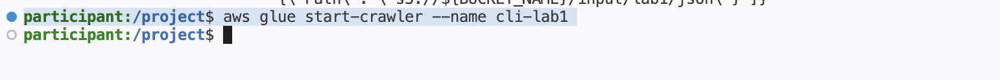

### Step 5: Check Crawler Status

You can monitor the crawler's progress by checking its status:

```bash
aws glue get-crawler --name cli-lab1
```

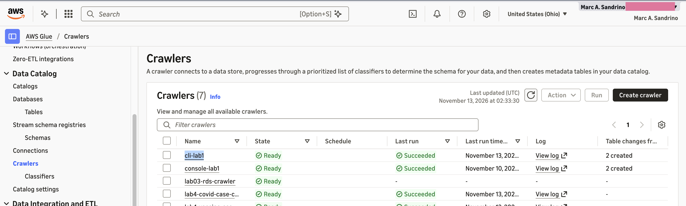

### Step 6: Verify the Crawler in Console

After the crawler completes successfully, you can verify it in the AWS Console. Navigate to the Crawlers section where you'll see the `cli-lab1` crawler with a "Ready" state and "Succeeded" status.

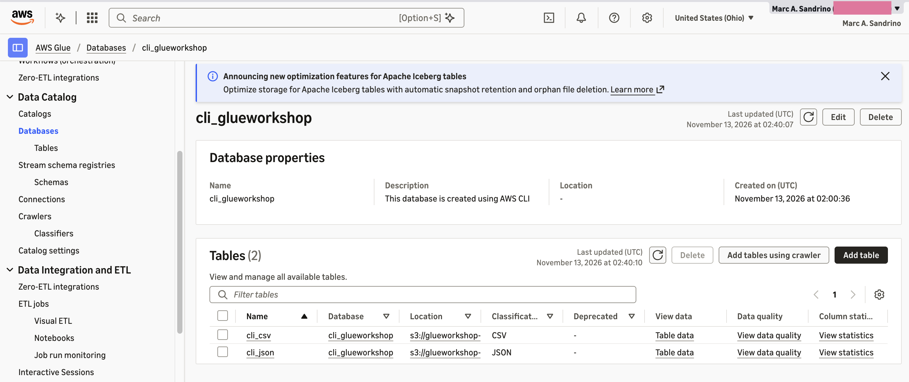

### Step 7: Verify the Database and Tables

Navigate to the `cli_glueworkshop` database in the AWS Console to verify that the tables were created. You will see two newly populated tables with the `cli_` prefix: **cli_csv** and **cli_json**.

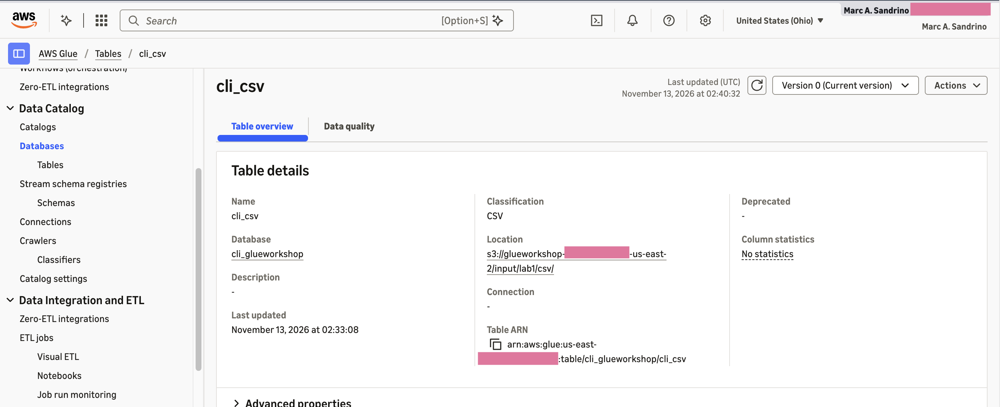

### Step 8: Explore CLI CSV Table Schema

Click on the `cli_csv` table to view its detailed schema showing:
- Classification: CSV
- S3 Location: `s3://glueworkshop-*/input/lab1/csv/`
- Description and connection details
- 14 columns with inferred data types

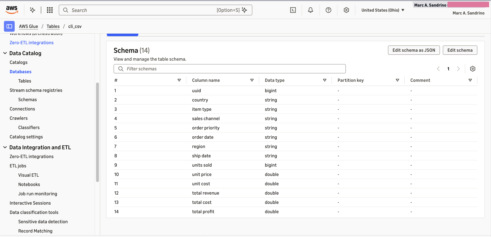

**Schema Details (14 columns):**
1. uuid - bigint
2. country - string
3. item_type - string
4. sales_channel - string
5. order_priority - string
6. order_date - string
7. region - string
8. ship_date - string
9. units_sold - bigint
10. unit_price - double
11. unit_cost - double
12. total_revenue - double
13. total_cost - double
14. total_profit - double

### Step 9: Explore CLI JSON Table Schema

Similarly, the `cli_json` table shows:
- Classification: JSON
- S3 Location: `s3://glueworkshop-*/input/lab1/json/`
- 17 columns with inferred data types

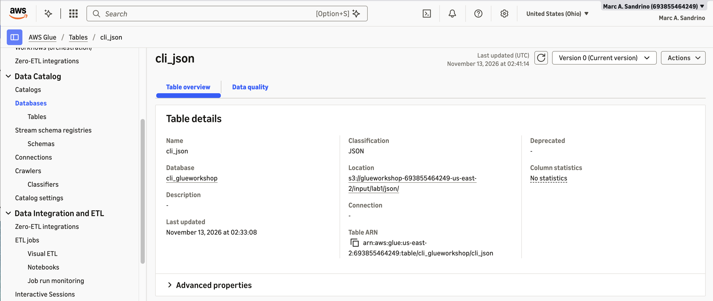

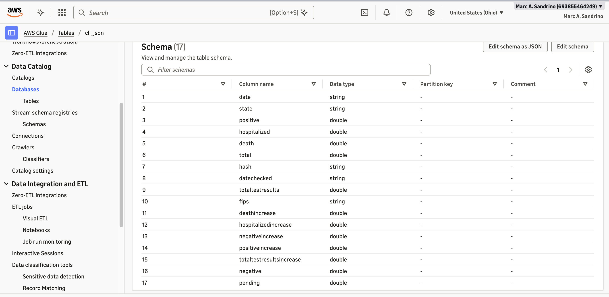

**Schema Details (17 columns):**
1. date - string
2. state - string
3. positive - double
4. hospitalized - double
5. death - double
6. total - double
7. hash - string
8. datechecked - string
9. totaltestresults - double
10. fips - string
11. deathincrease - double
12. hospitalizedincrease - double
13. negativeincrease - double
14. positiveincrease - double
15. totaltestresultsincrease - double
16. negative - double
17. pending - double

## ✅ Key Takeaways

### CLI vs Console Trade-offs
- **AWS CLI** provides scriptable, repeatable infrastructure deployment
- Commands can be version-controlled and integrated into CI/CD pipelines
- Essential skill for production-grade data engineering workflows
- Requires understanding of JSON syntax and command structure
- Ideal for automation and batch operations

### Technical Insights
- Same crawler functionality available through both Console and CLI
- Programmatic access enables Infrastructure as Code (IaC) practices
- Environment variables (`${BUCKET_NAME}`) make scripts reusable across environments
- CLI output confirms operations without requiring Console navigation
- Both approaches produce identical Data Catalog results

### Professional Development
- Strengthens your ability to work with infrastructure scripts
- Prepares you to execute deployment scripts from Data Architects
- Demonstrates versatility in AWS tooling
- Essential for DevOps and DataOps practices
- Shows progression from visual learning to programmatic implementation

### Schema Discovery
- AWS Glue automatically infers the same schemas whether created via Console or CLI
- The `table-prefix` parameter (`cli_`) helps organize and identify tables by creation method
- Crawler successfully handles multiple data formats (CSV, JSON) in a single run
- Metadata catalog remains consistent across different creation methods

## 🔧 Common Commands Reference

```bash
# List all databases
aws glue get-databases

# Get specific database details
aws glue get-database --name cli_glueworkshop

# List all crawlers
aws glue list-crawlers

# Get crawler details
aws glue get-crawler --name cli-lab1

# Get crawler metrics
aws glue get-crawler-metrics --crawler-name-list cli-lab1

# List tables in a database
aws glue get-tables --database-name cli_glueworkshop

# Get specific table schema
aws glue get-table --database-name cli_glueworkshop --name cli_csv

# Delete a crawler (cleanup)
aws glue delete-crawler --name cli-lab1

# Delete a database (cleanup)
aws glue delete-database --name cli_glueworkshop
```

## 📸 Screenshots Reference

All screenshots in this directory document the complete CLI workflow from data inspection through schema verification.

## 🔗 Next Steps

After completing both Lab 1.1 (Console) and Lab 1.2 (CLI), you now understand:
- How to create Glue Data Catalog resources using multiple methods
- When to use Console vs CLI approaches
- How to automate metadata catalog operations

Proceed to [Lab 02: Basic Transformations](../../lab-02-basic-transformations/) to learn how to transform and process your cataloged data using AWS Glue ETL jobs.
