# Lab 2: Working with AWS Glue Studio - Basic Transformations

## 📚 Overview

Welcome to Lab 02: Working with AWS Glue Studio!

**AWS Glue Studio** is a visual interface that simplifies authoring, running, and monitoring Extract, Transform, and Load (ETL) jobs on AWS Glue's serverless Apache Spark platform. While developing ETL pipelines locally often relies on orchestration platforms like Apache Airflow / Mage.ai for visual DAG management or Jupyter Notebooks for PySpark job authoring, Glue Studio brings these capabilities into a single, cloud-native experience. It empowers users of all technical backgrounds - from low-code users accustomed to drag-and-drop interfaces to Spark developers - to build scalable big data workflows without managing infrastructure.

## 🎯 Learning Objectives

In this lab, we will focus specifically on constructing a standard ETL Job utilizing **Basic Transformations**:

### Visual Job Authoring
Learn how to set up a visual node graph to ingest data, apply schema mappings, and output results cleanly.

### Basic Out-of-Box Transformations
Perform fundamental data manipulations - such as dropping unnecessary fields, renaming columns, and casting data types - using Glue Studio's built-in visual transforms.

### Cost-Conscious Execution
By focusing strictly on essential batch transformations and skipping resource-heavy streaming or advanced third-party modules, we keep computing footprint and DPU usage minimal to remain optimal for AWS Free Tier hands-on practice.

By the end of this session, you will successfully configure and execute a foundational Glue ETL job that demonstrates how visual pipeline creation seamlessly translates into underlying Spark operations. Let's get started!

## 🛠️ Building the ETL Pipeline

### Step 1: Create New Visual ETL Job

To start building our simple ETL job in AWS Glue Studio, navigate to **Data Integration and ETL**, select **ETL Jobs**, and click on **Visual ETL**. 

Once inside the visual interface, rename the job from "Untitled" to `glueworkshop-lab02-basic-job`, and notice how the generated script is locked to its default state for now.

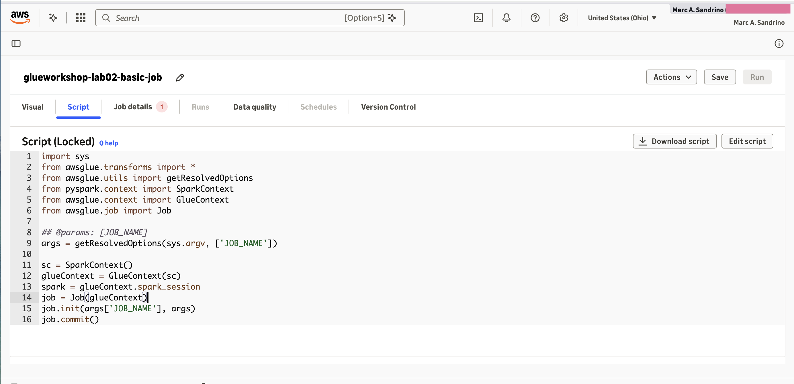

### Step 2: Configure Job Details

Next, head over to the **Job Details** tab to configure your project's specific requirements:

- **IAM Role**: Choose `AWSGlueServiceRole-glueworkshop`
- **Glue Version**: Set to `Glue 4.0 - Support Spark 3.3, Scala 2, Python 3`
- **Requested Number of Workers**: Set to `4`
- **Job Bookmarks**: Disable
- **Number of Retries**: Set to `0`
- Save your progress

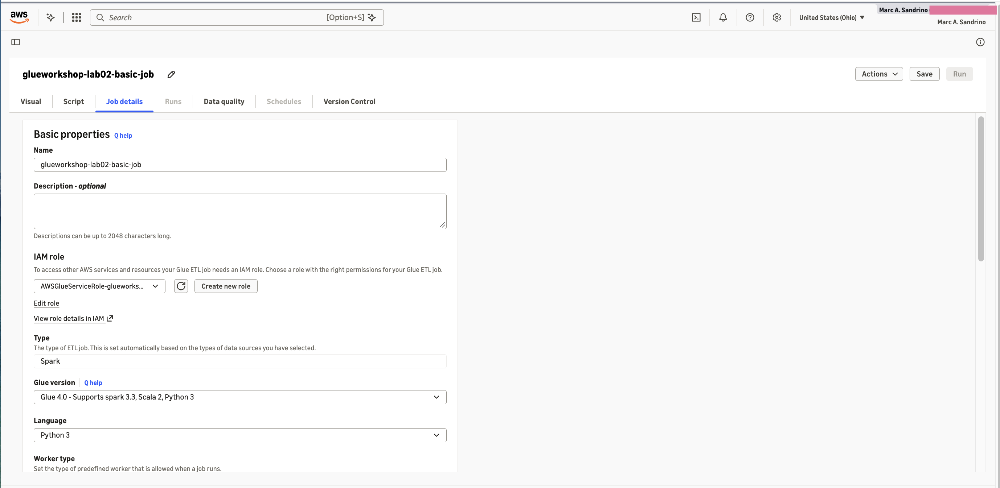

### Step 3: Add COVID Data Source

Returning to the **Visual** tab, click the plus (+) button, go to **Sources**, select **AWS Glue Data Catalog**, and configure the node:

- **Database**: Choose `console_glueworkshop`
- **Table**: Select `json`
- **Node Name**: Rename to `COVID data`

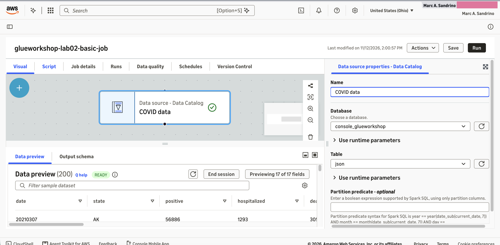

### Step 4: Drop Unnecessary Fields

From there, add a **Drop Fields** transform to remove the following columns:
- `date`
- `state`
- `deathincrease`
- `hospitalizedincrease`

Confirm that the data preview settings point to `AWSGlueServiceRole-glueworkshop`, then save your changes.

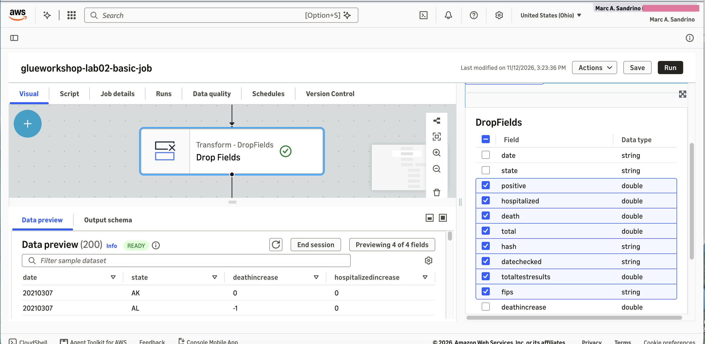

### Step 5: Filter for Specific States

Next, add a **Filter** transform:
- Select the **Global AND** radio button
- Add a condition where the key `state` **matches** `NY|CA`

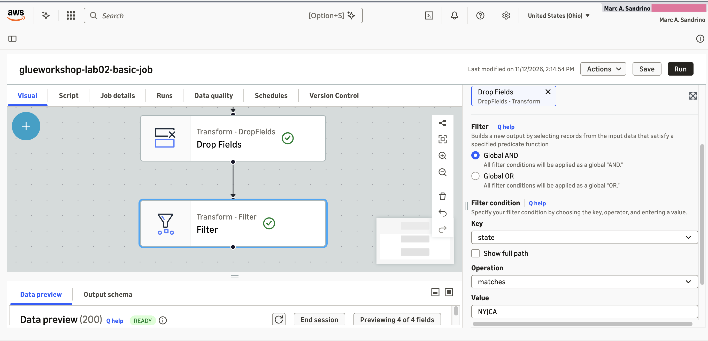

### Step 6: Change Data Types

Follow this up by adding a **Change Schema** transform to update the data types for both `deathincrease` and `hospitalizedincrease` to integers (`int`).

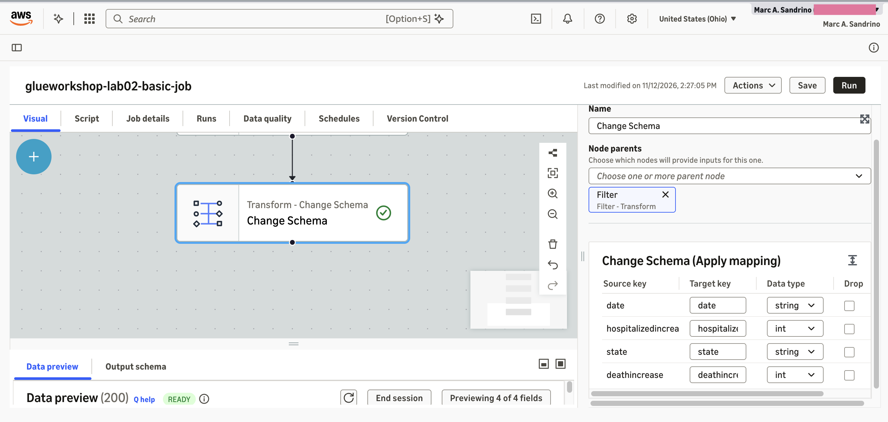

### Step 7: Add State Name Reference Data

To pull in the secondary reference dataset, click the plus (+) button again, go to **Sources**, choose **Amazon S3**:

- **S3 URL**: Enter `s3://${BUCKET_NAME}/input/lab2/state/` (make sure you finished the Lab 1 setup to access this path)
- Click **Infer schema**
- **Node Name**: Name it `State Name`

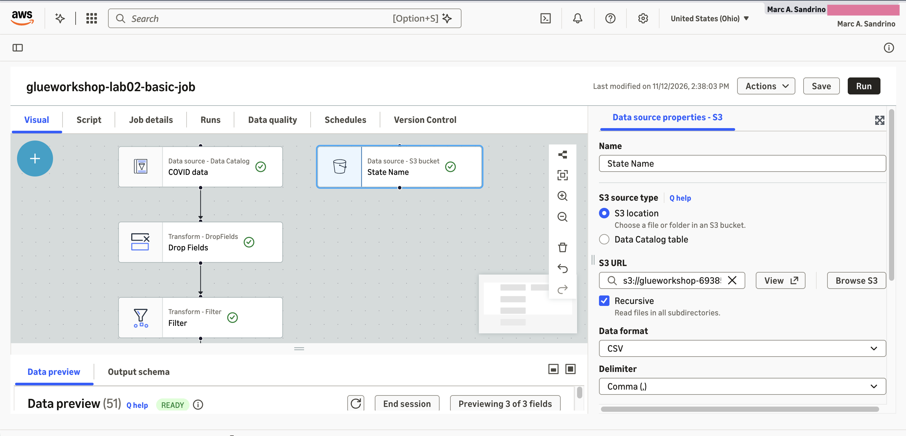

### Step 8: Join the Datasets

To merge the two datasets, highlight the **Change Schema** box, add a **Join** transform:

- **Node Parent**: Select `State Name`
- **Join Type**: Choose `Left Join`
- **Join Conditions**: Map the `Change Schema.state` column to the `State Name.code` column

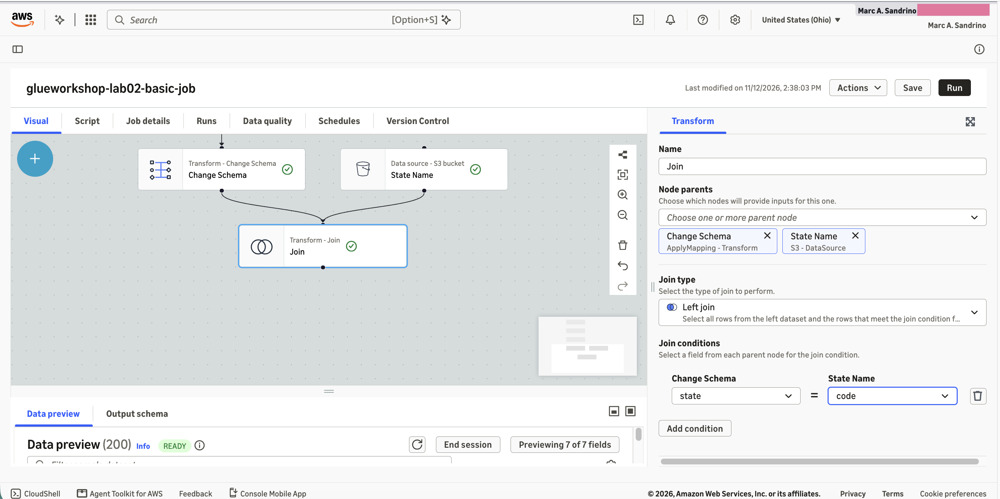

### Step 9: Drop Unnecessary Columns

Follow this with another **Change Schema** transform named `Drop Columns` where you select `state` and `Abbrev` to exclude them from the dataset.

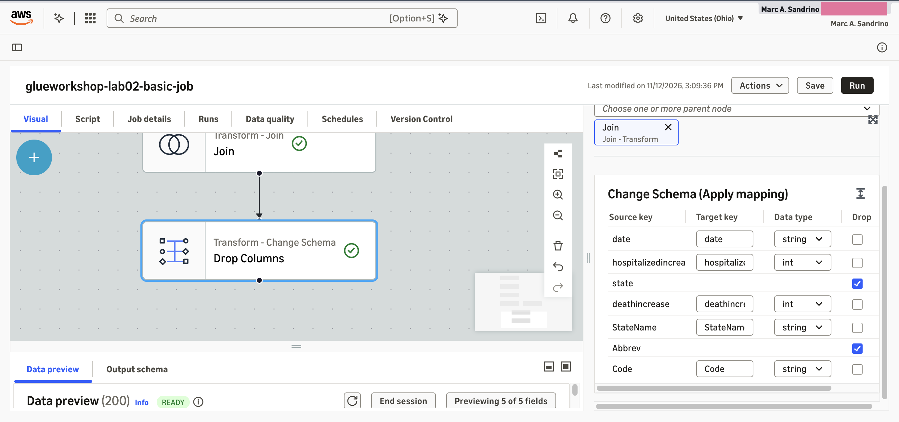

### Step 10: Aggregate the Data

Afterward, add an **Aggregate** transform to:
- **Group by**: `StateName`
- **Aggregate Functions**: Calculate the `sum` for both `deathincrease` and `hospitalizedincrease`

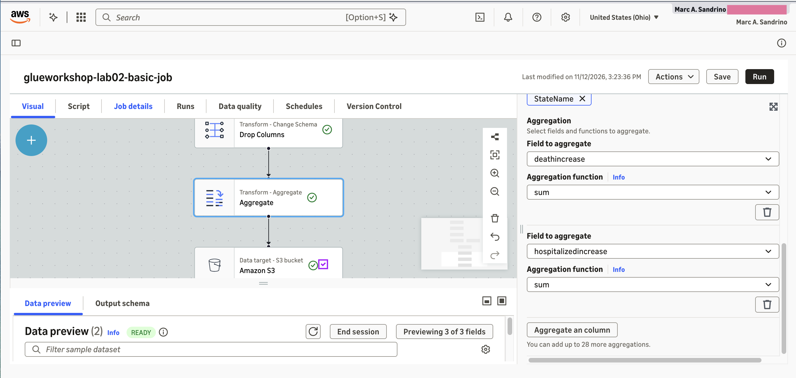

### Step 11: Configure S3 Output Target

Finally, add an **Amazon S3** node from the **Targets** tab:

- **Format**: Set to `JSON`
- **Compression Type**: Set to `None`
- **Target Location**: Point to `s3://${BUCKET_NAME}/output/lab02/basic/`

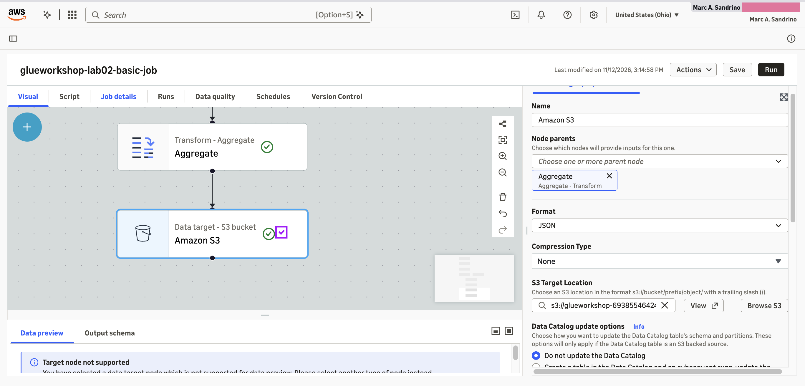

### Step 12: Run the Job

Save your job and click **Run**. While the execution is pending, give it a moment until the status switches to **Succeeded**.

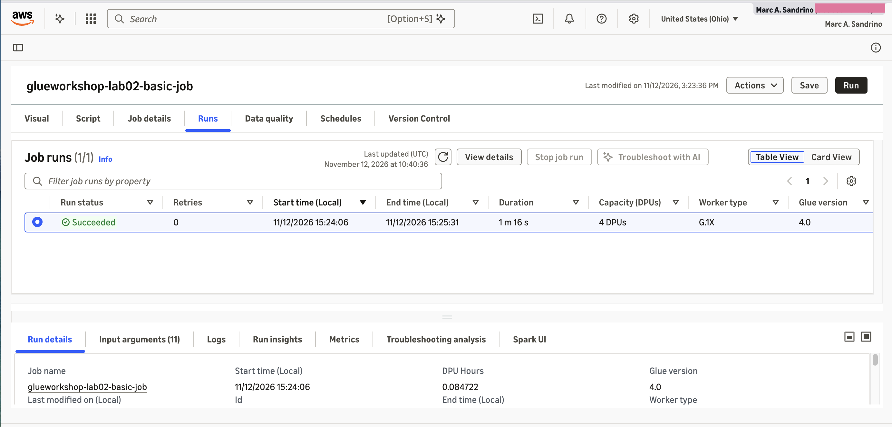

### Step 13: Download and Inspect Results

Once completed, you can download the results directly to the VS Code IDE we set up earlier by running:

```bash
aws s3 cp s3://${BUCKET_NAME}/output/lab02/ /project/glue-workshop/output/lab02 --recursive
```

Inspect the generated output files in the left navigation pane.

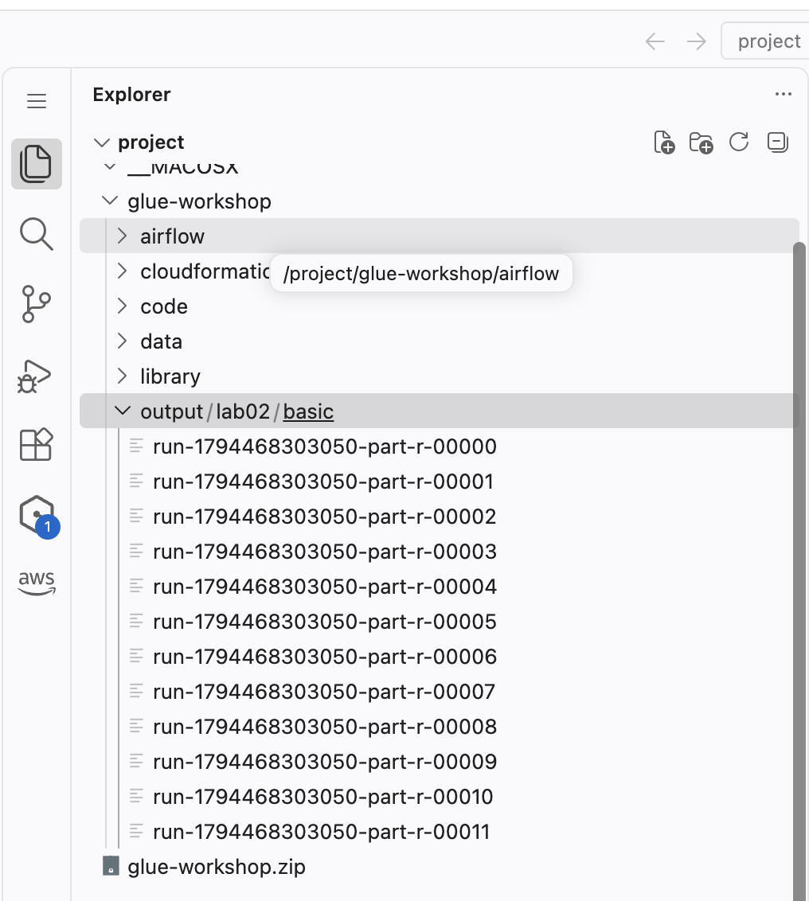

## ✅ Key Takeaways

### Visual Pipeline Development

Building pipelines in AWS Glue Studio feels remarkably intuitive, much like dragging and dropping tasks when orchestrating workflows in Databricks. But as a **Data Engineer Support Instructor for the For The Women (FTW) Foundation**, I always tell my scholars that **the real challenge isn't connecting nodes on a canvas. It's paying close attention to the attributes, schemas, and configurations behind every task so they match real-world project requirements.**

In production, a Data Architect usually makes the final call on high-level pipeline design, but **it's up to us as Data Engineers to implement those transformations with discipline and precision.**

### Fail Fast, Fail Visibly

One lesson I share often is the importance of **failing fast and failing visibly**:

#### Fail Early, Recover Cleanly
I would much rather see a pipeline fail early, where we can isolate the bottleneck, check the logs, and re-run only the failed task, than let a flawed job quietly run to completion.

#### Prevent Silent Failures
When unvalidated transformations or misconfigured retries slip through unnoticed, they create three major business risks:
1. **Unexpected spikes in cloud compute costs**
2. **Corrupted downstream data**
3. **Flawed executive decisions based on bad analytics**

### Professional Engineering Discipline

**Mastering low-code tools like AWS Glue Studio doesn't mean skipping data engineering fundamentals. It means pairing visual speed with strict data governance, cost awareness, and intentional pipeline design.**

## 🎓 Technical Skills Demonstrated

### ETL Transformations
- ✅ **Drop Fields**: Removing unnecessary columns to reduce data footprint
- ✅ **Filter**: Applying conditional logic to select specific records
- ✅ **Change Schema**: Type casting and data type conversions
- ✅ **Join**: Merging datasets from multiple sources (Data Catalog + S3)
- ✅ **Aggregate**: Grouping and calculating summary statistics

### Data Sources
- ✅ **AWS Glue Data Catalog**: Leveraging cataloged metadata from Lab 1
- ✅ **Amazon S3**: Direct file ingestion with schema inference
- ✅ **Multiple Source Integration**: Combining structured data from different origins

### Best Practices
- ✅ **Cost Optimization**: Using 4 workers with job bookmarks disabled for learning
- ✅ **Configuration Management**: Proper IAM role and Glue version selection
- ✅ **Data Preview**: Validating transformations at each step
- ✅ **Output Management**: Structured JSON output to S3 for downstream consumption

## 🔧 Pipeline Architecture

```
COVID data (Data Catalog)           State Name (S3)
        ↓                                  ↓
   Drop Fields                             |
        ↓                                  |
     Filter                                |
        ↓                                  |
  Change Schema ←─────── Left Join ────────┘
        ↓
  Drop Columns
        ↓
    Aggregate
        ↓
   Amazon S3 (Output)
```

## 📊 Data Flow Summary

1. **Ingest** COVID-19 data from Glue Data Catalog (`console_glueworkshop.json`)
2. **Clean** by dropping unnecessary date and state-level columns
3. **Filter** to focus on NY and CA states only
4. **Transform** data types for proper aggregation
5. **Enrich** by joining with state name reference data from S3
6. **Aggregate** death and hospitalization metrics by state name
7. **Output** final summarized data as JSON to S3

## 🔗 Next Steps

After completing this lab, proceed to [Lab 04: Glue Job Orchestration](../lab-04-glue-job-orchestration/) to learn how to orchestrate multiple ETL jobs into automated workflows.

## 📝 Prerequisites

- Completion of [Lab 1: Glue Data Catalog](../lab-01-glue-data-catalog/) for cataloged data sources
- AWS Glue IAM role with S3 access permissions
- S3 bucket with input data in `input/lab2/state/` path
- Basic understanding of ETL concepts and data transformations
