# Lab 4: Glue Job Orchestration

## 📚 Overview

Welcome to Lab 04: Glue Job Orchestration!

In this session, we will explore **Glue Job Orchestration**, a core capability within AWS Glue. As an **AWS Community Builder candidate in the Data Engineering category**, mastering workflows is essential for building and visualizing complex Extract, Transform, and Load (ETL) pipelines that coordinate multiple crawlers, jobs, and triggers in a single, unified flow.

## 🔄 Local vs Cloud Orchestration

To put this into perspective, if you are working locally on your machine, the closest equivalent to pipeline scheduling is **Cron**, where you schedule recurring tasks using Python scripts or configuration files like YAML. However, while local cron jobs are great for lightweight tasks, **production environments demand robust cloud orchestration**.

### AWS Orchestration Ecosystem

During my time mentoring at the **For The Women (FTW) Foundation**, I emphasized that a critical responsibility of any data engineer is **actively monitoring individual task executions and pipeline runs**, much like how we oversee jobs in Databricks. 

Across the broader AWS ecosystem, two primary services handle advanced orchestration:
- **AWS Step Functions**
- **Amazon EventBridge**

When I was preparing for the **Databricks Certified Data Engineer Professional exam**, I noticed how closely AWS Step Functions parallels Databricks Workflows, as both give you clear visibility into failed tasks that need immediate attention, allowing you to **repair and re-run just the broken step rather than restarting the entire pipeline from scratch**.

### Lab Focus

For this walkthrough, we will focus strictly on **Glue Workflows** to build a strong foundation in the fundamentals. Before diving into the build, we will review Workflow Tasks to understand how Glue defines and tracks run statuses across each component. 

More advanced topics, such as **Step Functions**, **Event Driven Workflows**, and **Managed Workflows for Apache Airflow (MWAA)**, will be set aside for now so we can keep our focus simple, cost-effective, and easy to follow. Let's get started!

## 🛠️ Creating an AWS Glue Workflow

### Step 1: Initialize the Workflow

Now, let's create a workflow in AWS Glue under **Data Integration and ETL**. When you click on **Workflows**, you will notice that it is completely empty, and you will build it yourself following these instructions:

1. Go to the AWS Glue console
2. Click **Workflows (orchestration)** on the left menu
3. Click **Add workflow**
4. Set the **Workflow name** to `COVID-19-workflow`
5. Click **Create workflow** at the bottom

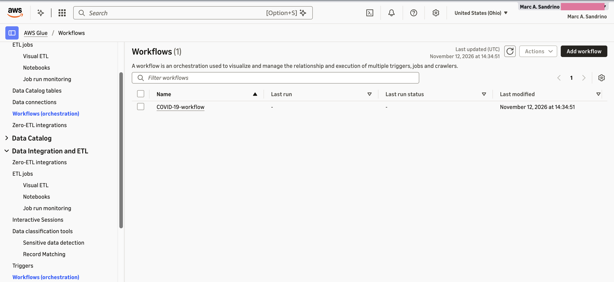

### Step 2: View Empty Workflow

Click into the **COVID-19-workflow** link to view its details. The visual graph at the bottom will be empty at the moment.

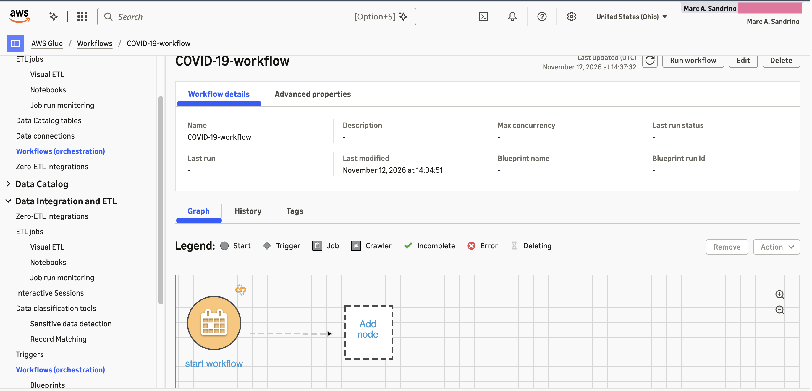

### Step 3: Add Schedule Trigger

Once you have done that, click into the COVID-19-workflow and add the trigger by following these settings:

1. Click **Add trigger**
2. Select the **Add new** tab
3. Set up the new trigger with the following settings:
   - **Name**: `start workflow`
   - **Trigger type**: Select `Schedule`
   - **Frequency**: Select `Hourly`
4. Click **Add**

Once created, you will see a circular start node appear on the workflow graph.

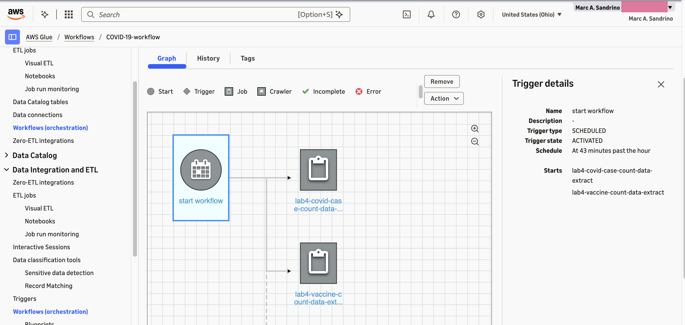

### Step 4: Add Extract Jobs

The next step is to click the **start workflow** node to highlight it:

1. Click the **Action** dropdown
2. Click **Add jobs/crawlers to trigger**
3. Select the **Jobs** tab
4. Choose `lab4-covid-case-count-data-extract` and `lab4-vaccine-count-data-extract` from the list
5. Click **Add**

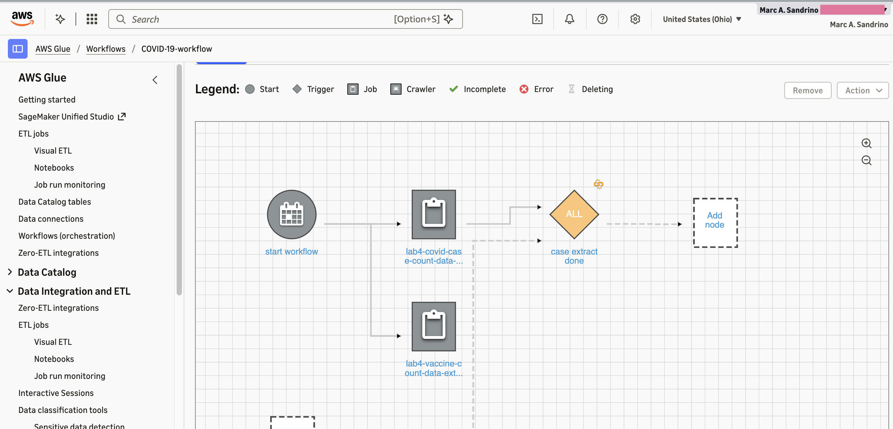

### Step 5: Add Case Extract Done Trigger

Afterward, click the `lab4-covid-case-count-data-extract` node, and a new dotted diamond-shaped "Add trigger" node will appear. Click that trigger node and configure it with the following settings, then click **Add**:

- **Name**: `case extract done`
- **Trigger type**: Select `Event`
- **Trigger logic**: Select `Start after ALL watched event`

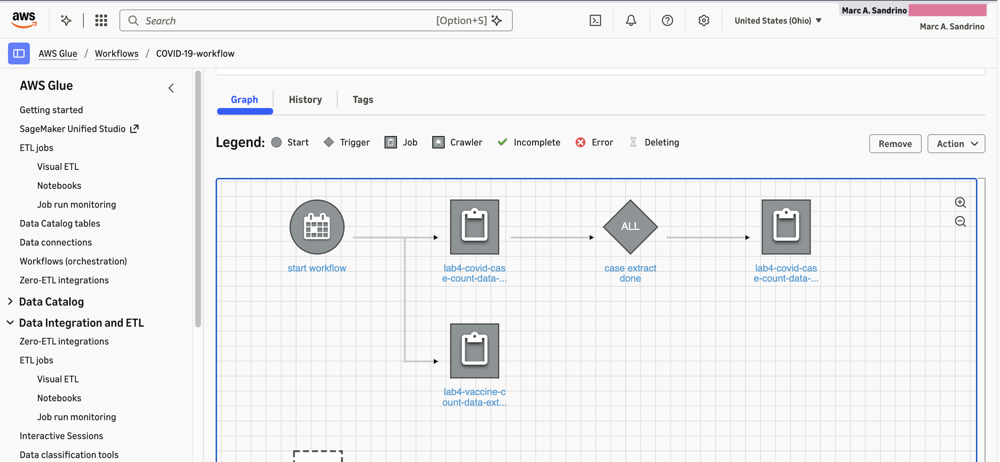

### Step 6: Add Case Process Job

Once the diamond shape is ready:

1. Click the `case extract done` trigger
2. Click the **Action** dropdown
3. Click **Add jobs/crawlers to trigger**
4. Select the **Jobs** tab
5. Choose `lab4-covid-case-count-data-process` from the list
6. Click **Add**

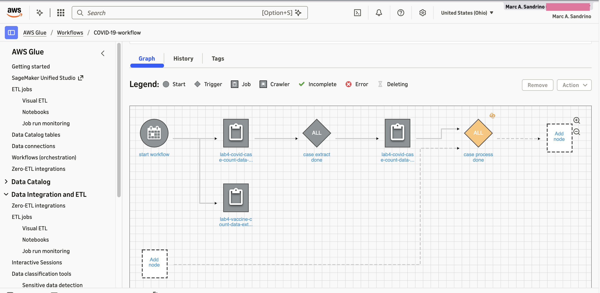

### Step 7: Add Vaccine Extract Done Trigger

Next, click the `lab4-vaccine-count-data-extract` node to bring up another Add trigger node. Click it and set up the trigger with the following settings, then click **Add**:

- **Name**: `vaccine extract done`
- **Trigger type**: Select `Event`
- **Trigger logic**: Select `Start after ALL watched event`


### Step 8: Add Vaccine Process Job

Following that:

1. Click the `vaccine extract done` trigger
2. Click the **Action** dropdown
3. Click **Add jobs/crawlers to trigger**
4. Select the **Jobs** tab
5. Choose `lab4-vaccine-count-data-process` from the list
6. Click **Add**

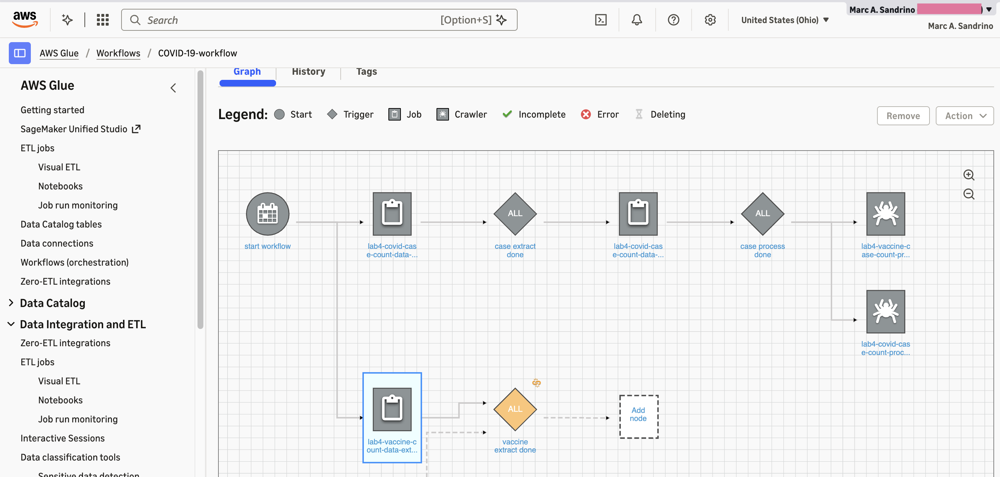

### Step 9: Configure Case Process Done Trigger

For the next step:

1. Click the `case process done` trigger
2. Click the **Action** dropdown
3. Click **Add jobs/crawlers to watch**
4. Select the **Jobs** tab
5. Choose `lab4-vaccine-count-data-process` from the list

The `case process done` trigger will now monitor events from both jobs.

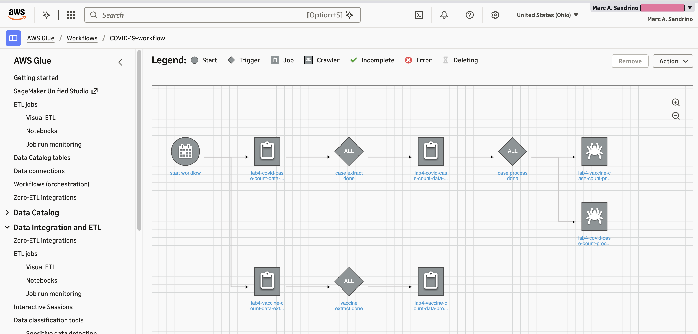

### Step 10: Complete Workflow Configuration

We have now reached the finish line with the complete workflow architecture in place.

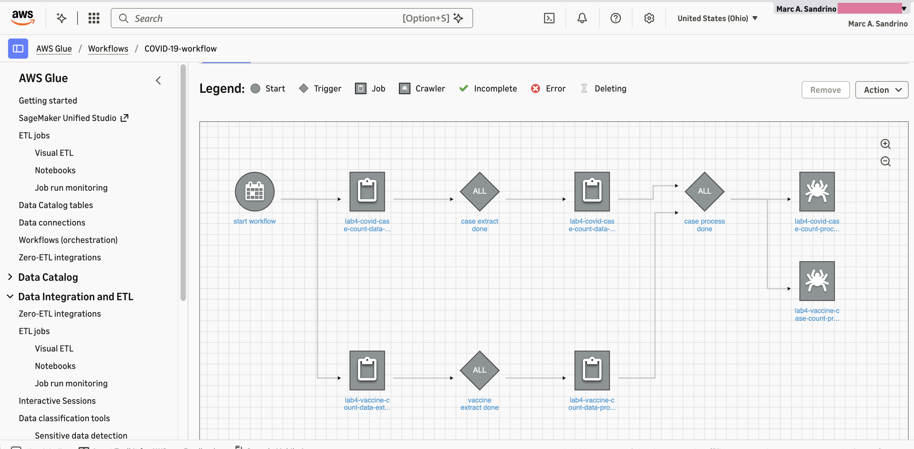

### Step 11: Run the Workflow

We are finished creating the workflow. Click **Run Workflow** in the top-right corner of the screen.

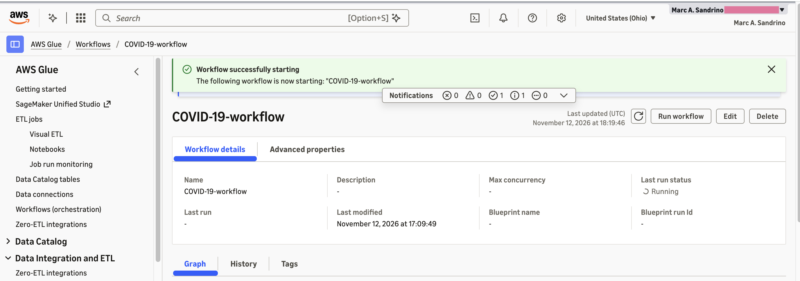

### Step 12: Verify Completion

Check if the workflow is complete, and once finished, review the execution history.

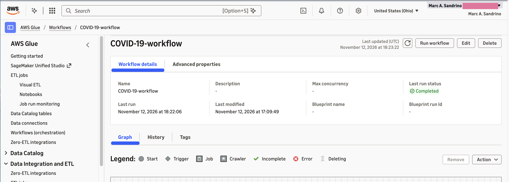

### Step 13: Review Execution History

In the history, I saw that it completed successfully with no failed pipelines.

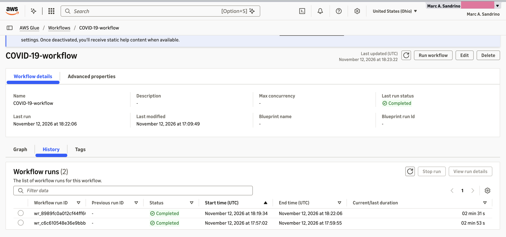

### Step 14: View Final Workflow Map

The complete workflow map shows all jobs, triggers, and dependencies:

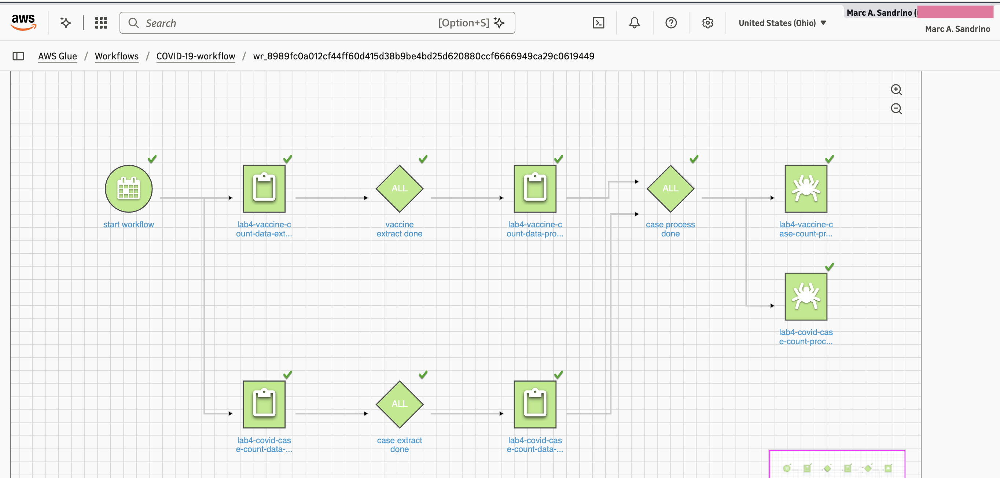

## 🎯 Design Decision: Skipping Error Testing

> **Note**: Regarding instructions 16, 17, 18, and 19, I skipped them because their purpose is to test the pipeline by injecting a `lab-4-raise-error`. From my experience with Databricks workflows, once a pipeline component fails, it typically halts and does not blindly proceed to the next flow.
>
> As I learned here, **being a data engineer requires you to be pragmatic about whether to push through with subsequent instructions, keeping potential cause-and-effect outcomes in mind.**

## ✅ Key Takeaways

### Data Quality and Data Integrity: Non-Negotiable Principles

As a data engineer, **I strongly disagree with letting a pipeline proceed to the next task or job after an upstream step has failed**, which is the exact same principle I apply in Databricks. Pushing a broken pipeline forward compromises two critical pillars:

#### Data Quality
Allowing corrupted or incomplete records to pass through degrades overall data quality, leading to urgent escalations and a loss of trust in the data engineering team.

#### Data Integrity
Once data integrity is compromised, stakeholders and clients lose confidence in your reporting, knowing the underlying data can no longer be trusted.

### FTW Foundation Teaching Philosophy

During my time mentoring at the **For The Women (FTW) Foundation**, I constantly reminded our scholars (women in tech): **no matter how repetitive data quality checks feel, a failed job should never trigger downstream tasks**. 

If a job fails:
1. ✋ **Stop the pipeline**
2. 🔍 **Fix the root cause**
3. 🔄 **Re-run only the affected task**

As I always say: **I would much rather deal with a failed pipeline than let a flawed job run continuously, producing bad data and racking up tremendous cloud compute costs.**

### Service Level Agreements (SLAs)

Regarding job **Service Level Agreements (SLAs)**, following company standards is non-negotiable. For example:

- **Business Requirement**: Data must transfer to the next pipeline within 15 minutes
- **My Engineering Buffer**: I proactively engineer and monitor the job with a stricter internal buffer, such as **12 minutes**
- **Safety Margin**: If execution runs slightly past 12 minutes, it still safely lands within the 15-minute window without breaching the official SLA

### Configuration Discipline

Through this lab, I learned how to effectively schedule and orchestrate tasks and jobs using AWS Glue Workflows. **Even though it offers a visual drag-and-drop interface, mastering how to configure it properly requires aligning every trigger and dependency with real business requirements and the overarching design set by the Data Architect.**

## 🏗️ Workflow Architecture

### Pipeline Components

The COVID-19-workflow consists of:

**Triggers:**
- `start workflow` - Scheduled hourly trigger
- `case extract done` - Event trigger after case extraction
- `vaccine extract done` - Event trigger after vaccine extraction  
- `case process done` - Event trigger watching both process jobs

**Jobs:**
- `lab4-covid-case-count-data-extract` - Extract COVID case data
- `lab4-covid-case-count-data-process` - Process COVID case data
- `lab4-vaccine-count-data-extract` - Extract vaccine data
- `lab4-vaccine-count-data-process` - Process vaccine data

### Workflow Logic

```
start workflow (Hourly Schedule)
    ↓
    ├─→ lab4-covid-case-count-data-extract
    │       ↓
    │   case extract done (Event: ALL)
    │       ↓
    │   lab4-covid-case-count-data-process
    │       ↓
    │   case process done (Event: ALL) ──┐
    │                                    │
    └─→ lab4-vaccine-count-data-extract  │
            ↓                             │
        vaccine extract done (Event: ALL) │
            ↓                             │
        lab4-vaccine-count-data-process ──┘
```

## 🎓 Technical Skills Demonstrated

### Workflow Design
- ✅ Creating orchestrated workflows from scratch
- ✅ Configuring scheduled triggers (hourly frequency)
- ✅ Setting up event-based triggers
- ✅ Managing job dependencies with trigger logic
- ✅ Implementing parallel extraction paths
- ✅ Coordinating convergence with "ALL watched event" logic

### Operational Excellence
- ✅ Monitoring workflow execution status
- ✅ Reviewing run history and logs
- ✅ Understanding failure propagation
- ✅ Applying SLA buffer strategies
- ✅ Pragmatic decision-making on error testing

### Professional Engineering Practices
- ✅ Data quality validation at pipeline boundaries
- ✅ Fail-fast philosophy implementation
- ✅ Cost-conscious pipeline design
- ✅ Alignment with Data Architect standards

## 🔗 Related AWS Services

While this lab focuses on Glue Workflows, be aware of related orchestration services:

- **AWS Step Functions**: State machine-based orchestration with advanced branching
- **Amazon EventBridge**: Event-driven serverless integration
- **Amazon MWAA**: Managed Apache Airflow for complex DAGs
- **AWS Lambda**: Serverless functions for custom trigger logic

## 📋 Prerequisites

- Completion of previous labs with pre-configured Glue jobs:
  - `lab4-covid-case-count-data-extract`
  - `lab4-covid-case-count-data-process`
  - `lab4-vaccine-count-data-extract`
  - `lab4-vaccine-count-data-process`
- AWS Glue IAM role with appropriate permissions
- Understanding of ETL job execution and monitoring

## 🔗 Next Steps

After completing this lab, proceed to [Lab 06: Glue Data Quality in ETL Jobs](../lab-06-glue-data-quality-etl-jobs/) to learn how to implement data quality rules and validation checks in your ETL pipelines.
