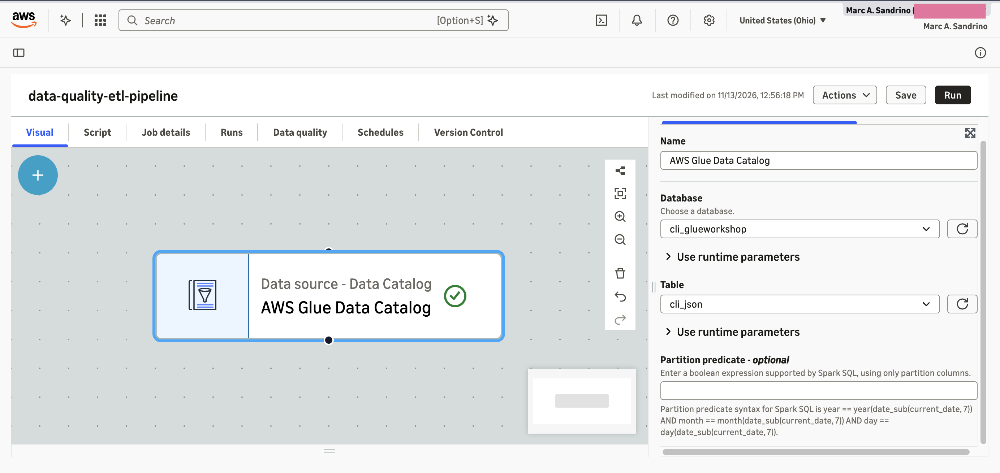
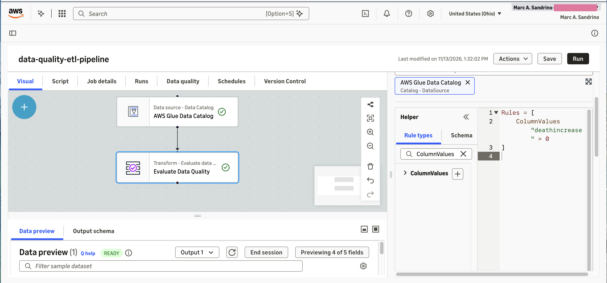
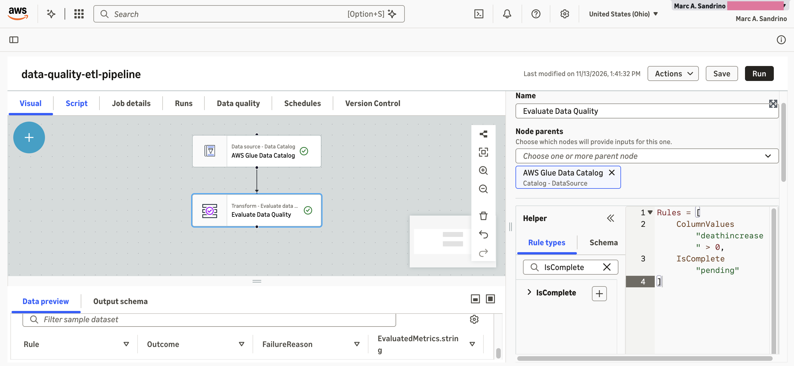
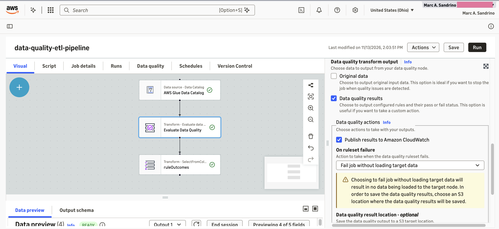
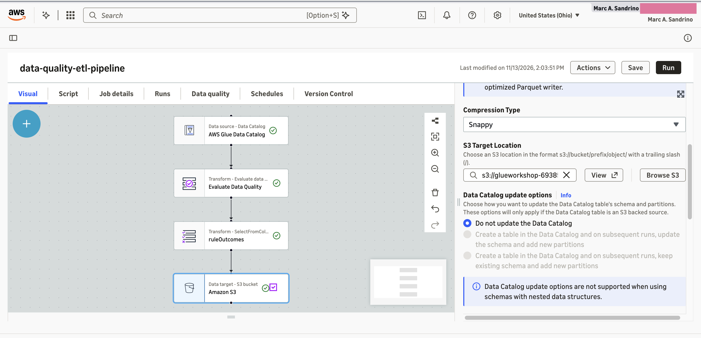
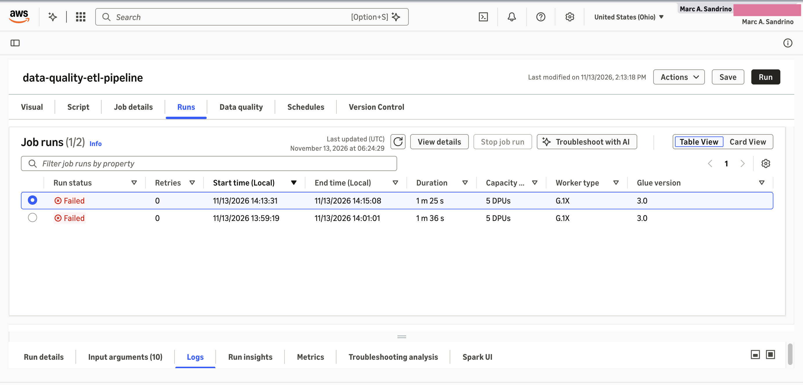
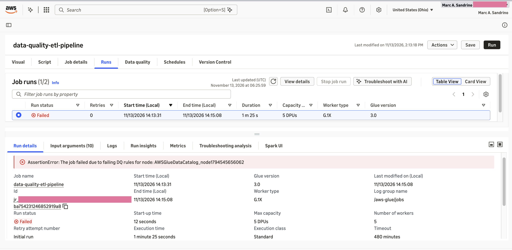
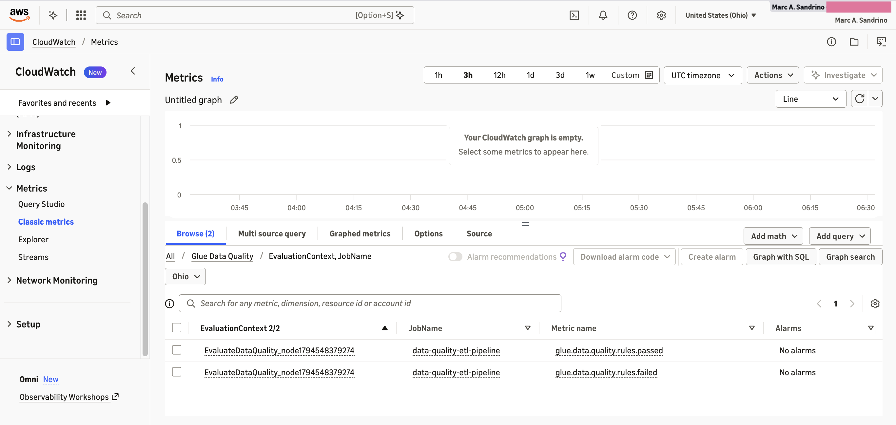
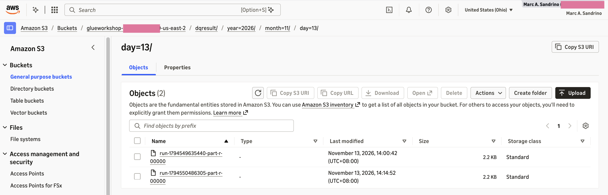

# Lab 6: Glue Data Quality with Glue Studio ETL Jobs

## 📚 Overview

Welcome to Lab 06: Working with AWS Glue Data Quality!

In this session, we will explore **AWS Glue Data Quality** and look at where it fits into modern cloud pipelines. At its core, AWS Glue Data Quality automatically computes dataset statistics, recommends baseline quality rules, monitors incoming records, and alerts you whenever data quality begins to deteriorate. This built-in feature helps ensure you consistently deliver high-quality, trustworthy data across your data lakes and ETL pipelines.

## 🎯 The Critical Importance of Data Quality

As a data engineer, **enforcing strict data quality is one of the most critical responsibilities in my workflow**. It ensures that data flows cleanly to downstream analytics teams and empowers management and stakeholders to make accurate decisions, regardless of whether they are reviewing sales metrics or handling sensitive records that require immediate attention.

### Industry Equivalents

To put this into context, if you are working locally or within other ecosystems, the closest equivalents to AWS Glue Data Quality include:

- **Great Expectations** - Python-based data validation framework
- **dbt tests** - Built-in and custom data quality tests
- **pytest** - Unit testing framework for data pipelines
- **SQLFluff** - SQL linting and validation
- **Databricks Delta Live Tables (DLT) expectations** - Real-time data quality monitoring

### FTW Foundation Standards

During our final coaching sessions before the scholars moved on to their capstone projects at the **For The Women (FTW) Foundation**, they had to present **concrete data quality measurements** to prove that their Databricks pipelines, integrated via VS Code, were reliable and production-ready.

## 🛡️ Zero-Tolerance Philosophy

As an aspiring **AWS Community Builder in the Data category**, I take a **zero-tolerance approach toward silent pipeline errors and poor cloud data hygiene**. 

Letting unvalidated data flow continuously through a pipeline:
- ❌ Wastes compute budget
- ❌ Inflates cloud costs
- ❌ Quickly erodes project management's trust

> **Remember: Data quality directly equals data integrity.**

Let's dive into Glue Data Quality with Glue Studio ETL Jobs so I can walk you through the hands-on setup and show you exactly why I hold such strict standards for data quality, even in my role as a **Support Instructor at FTW**.

## 🛠️ Step-by-Step Implementation Guide

### Step 1: Create the Visual ETL Job

1. Navigate to the **AWS Glue Studio Console**
2. Click the hamburger menu on the left pane and select **ETL jobs**
3. Choose the **Visual ETL** option and click **Create**



### Step 2: Configure Job Details

1. Rename your job to `data-quality-etl-pipeline`
2. Under the **Job details** tab, select your IAM role: `AWSGlueServiceRole-glueworkshop`
3. Change the **Number of requested workers** from 10 to **5**
4. Set the **Number of retries** to **0**
5. Keep all other settings as default
6. Click **Save** in the top-right corner
7. Switch back to the **Visual** tab

### Step 3: Add the Data Catalog Source

1. Click the plus icon (+) on the visual canvas
2. Select **AWS Glue Data Catalog** as your source
3. In the **Data source properties - Data Catalog** panel:
   - **Database**: Choose `cli_glueworkshop`
   - **Table**: Choose `cli_json` from the dropdown menu

### Step 4: Add the Evaluate Data Quality Transform

1. Click the plus icon (+) after your source node
2. Navigate to **Transforms**
3. Select **Evaluate Data Quality**



### Step 5: Write the Data Quality Ruleset

On the right-hand side panel, look for the **Ruleset editor** section. You can use out-of-the-box rule types or write custom rules.

Add your rules sequentially into the editor, making sure each rule ends with a comma if multiple rules are listed:

```
ColumnValues "deathincrease" > 0,
IsComplete "pending",
ColumnLength "state" = 2,
ColumnValues "fips" in ["53", "25", "51", "12", "34", "31", "18", "09", "26", "56", "44", "36", "42", "48", "50", "55", "41", "06", "17", "04", "13", "37", "33", "15", "08", "45", "47", "39", "32", "35", "24", "11", "02", "27", "20", "54", "21", "10", "05", "19", "28", "01", "29", "30", "38", "49", "16", "46", "22", "40", "23", "69", "60", "72", "78", "66"]
```



**Rule Breakdown:**
1. **ColumnValues "deathincrease" > 0** - Ensures death increase values are positive
2. **IsComplete "pending"** - Validates no null values in pending column
3. **ColumnLength "state" = 2** - Confirms state codes are exactly 2 characters
4. **ColumnValues "fips" in [...]** - Validates FIPS codes against a whitelist of valid US state/territory codes

### Step 6: Configure Data Quality Actions and Outputs

1. Under **Data quality actions**, check the box for **Publish results to Amazon CloudWatch**
2. Select the option to **Fail job without loading target data** from the dropdown menu
3. Browse and select your S3 bucket (`glueworkshop-accountid-us-east-2`) and add `dqresult/` as the suffix
4. Under the **Data Quality transform output** section, ensure the output option is correctly selected for **rule outcomes**



### Step 7: Add the Target Node

1. Click the plus icon (+) following the **ruleOutcomes** path
2. Select **Amazon S3** from the target options
3. Configure the S3 target properties:
   - **Node parents**: Ensure it is linked to `ruleOutcomes`
   - **S3 location**: Browse to your bucket (`glueworkshop-accountid-us-east-2`) and add `dqresultset/` as the suffix
   - Leave remaining options as default



### Step 8: Save and Run the Pipeline

1. Click **Save** in the top-right corner to save all configurations and rulesets
2. Click **Run** and navigate to the **Runs** tab to monitor job execution



## 🔍 Verifying Results and Monitoring

### Observe Job Failure (Expected)

Notice that the job execution **fails** because the dataset contains:
- ❌ Negative values in `deathincrease`
- ❌ Null values in `pending`

This validates our rule that **bad data must not propagate**.



### Review Data Quality Tab

1. Click into the failed run
2. Navigate to the **Data Quality** tab
3. Scroll down to inspect exactly which rules failed and why
4. Review the assertion error message: `AssertionError: The job failed due to failing DQ rules for node: AWSGlueDataCatalog_node1794545656062`

### Check CloudWatch Metrics

1. Go to the **Runs** section
2. Click on **Error logs** under CloudWatch logs
3. Navigate to **All metrics > Glue Data Quality**
4. Review:
   - `glue.data.quality.rules.passed`
   - `glue.data.quality.rules.failed`



### Inspect S3 Partitioned Output

Open your S3 results bucket to view the JSON output partitioned by date (`year=2026/month=11/day=13/`), which can be hooked into custom monitoring or dashboard tools.



## ✅ Key Takeaways: Lab 06 and Workshop Wrap-Up

### Deliberate Failure Testing
This workshop **intentionally designed the pipeline to fail** so we could learn how to locate errors and troubleshoot them as a core part of building robust quality measures.

### Zero Tolerance for Minor Flaws
AWS Glue Data Quality with Glue Studio ETL Jobs ensures that **even the smallest anomalies do not slip through unchecked**.

### Detailed Error Lineage
The instructions guide you directly to where mistakes happen, functioning much like **data lineage in Databricks** where you can inspect:
- 👤 Who ran the job
- 🕐 The exact timestamp
- 🔍 The root cause of the error

### Proactive Engineering over Escalation
As a data engineer, **catching and resolving errors immediately is a vital best practice**. Ignoring small issues inevitably leads to:
- 🚨 Severe management escalations
- 💔 Compromised data integrity
- 💸 Increased cloud costs
- 📉 Loss of stakeholder trust

## 🎓 Technical Skills Demonstrated

### Data Quality Rule Types
- ✅ **ColumnValues** - Validate numeric ranges and conditions
- ✅ **IsComplete** - Check for null/missing values
- ✅ **ColumnLength** - Verify string length constraints
- ✅ **Whitelisting** - Validate values against approved lists (FIPS codes)

### Monitoring & Observability
- ✅ CloudWatch integration for real-time metrics
- ✅ S3 partitioned output for historical analysis
- ✅ Failed job detection and alerting
- ✅ Rule-level failure attribution

### Pipeline Design Patterns
- ✅ **Fail-fast architecture** - Stop on quality violations
- ✅ **Separate outputs** - Quality results vs. data outputs
- ✅ **Audit trail** - Time-partitioned quality reports
- ✅ **No silent failures** - Explicit error propagation

### Professional Practices
- ✅ Reduced worker count (5 vs 10) for cost optimization
- ✅ Zero retries on quality failures (fail immediately)
- ✅ CloudWatch publishing for centralized monitoring
- ✅ S3 archival for compliance and troubleshooting

## 🏗️ Data Quality Architecture

```
AWS Glue Data Catalog (cli_glueworkshop.cli_json)
                ↓
    Evaluate Data Quality Transform
         ↓             ↓
   (Rules Pass)   (Rules Fail)
         ↓             ↓
   ruleOutcomes   Job Fails ✋
         ↓
   Amazon S3 (dqresultset/)
         ↓
   CloudWatch Metrics
```

## 📊 Quality Rules Applied

| Rule Type | Column | Validation | Purpose |
|-----------|--------|------------|---------|
| ColumnValues | deathincrease | > 0 | Prevent negative death counts |
| IsComplete | pending | No nulls | Ensure completeness |
| ColumnLength | state | = 2 | Validate state code format |
| ColumnValues | fips | In whitelist | Verify valid FIPS codes |

## 🔗 Related Quality Tools

### AWS Ecosystem
- **AWS Glue DataBrew** - Visual data preparation with profiling
- **Amazon EventBridge** - Event-driven quality alerts
- **AWS Lambda** - Custom quality validation functions
- **Amazon SNS** - Quality failure notifications

### Cross-Platform Experience
- **Databricks DLT Expectations** - Similar quality framework
- **Great Expectations** - Open-source validation
- **dbt** - SQL-based testing

## 📋 Prerequisites

- Completion of [Lab 01: Glue Data Catalog](../lab-01-glue-data-catalog/) for cataloged data sources
- AWS Glue IAM role with CloudWatch and S3 permissions
- Understanding of data quality principles
- Familiarity with ETL job monitoring

## 🎯 Real-World Applications

This lab prepares you for:
- 🏢 Production data pipeline validation
- 📊 Data governance and compliance
- 🔍 Root cause analysis of data issues
- 💰 Cost control through early failure detection
- 🎓 Data quality metrics reporting to stakeholders

## 💡 Pro Tips from FTW Foundation Teaching

1. **Always test with bad data first** - Prove your quality rules work
2. **Document every quality rule** - Explain the business reason
3. **Set up alerts immediately** - Don't wait for silent failures
4. **Review metrics weekly** - Track quality trends over time
5. **Fail fast, fix faster** - Stop bad data at the source

---

**Final Thought**: As I always tell my FTW scholars: *"A failed pipeline with clear error messages is infinitely better than a successful pipeline with corrupted data."*
